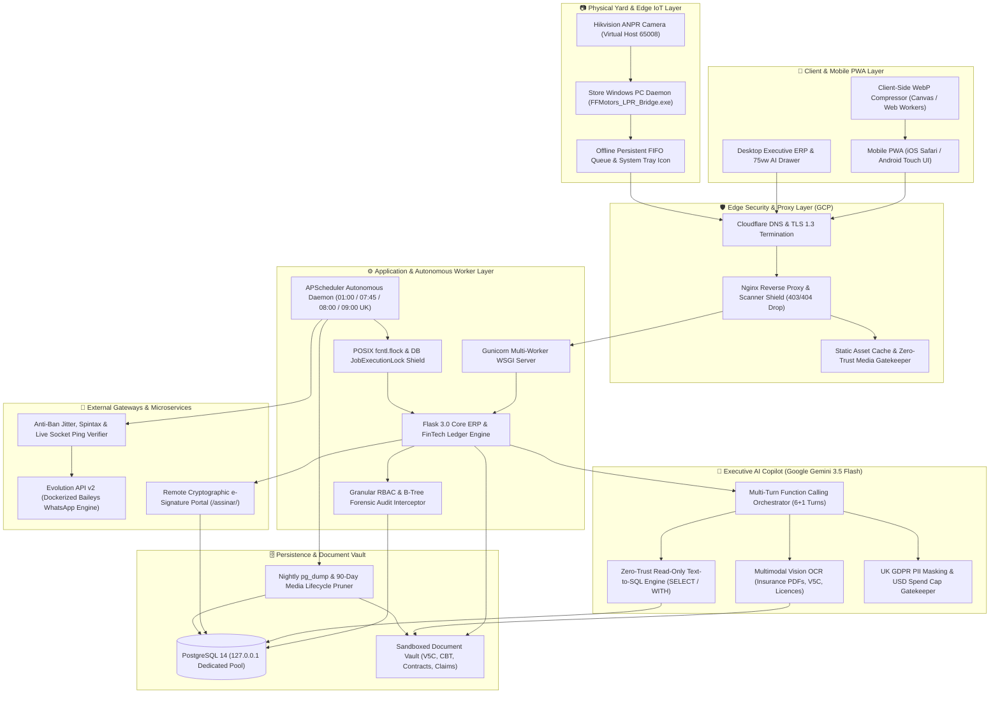
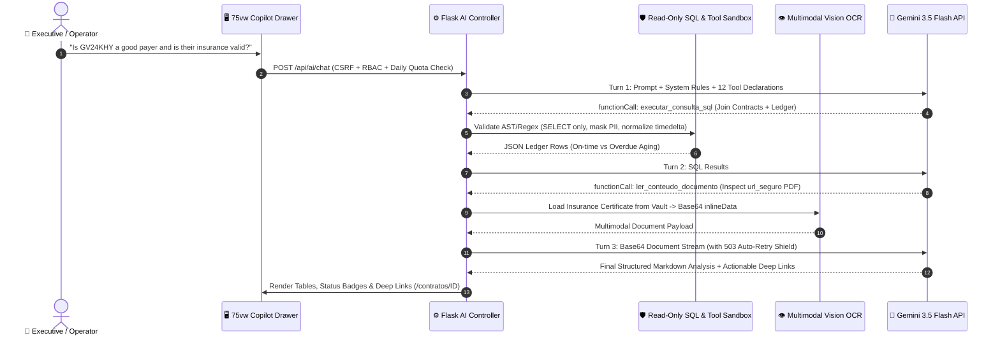
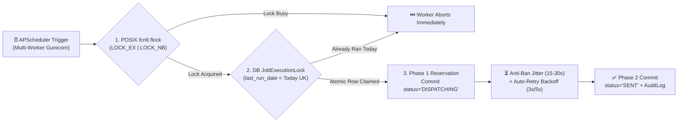
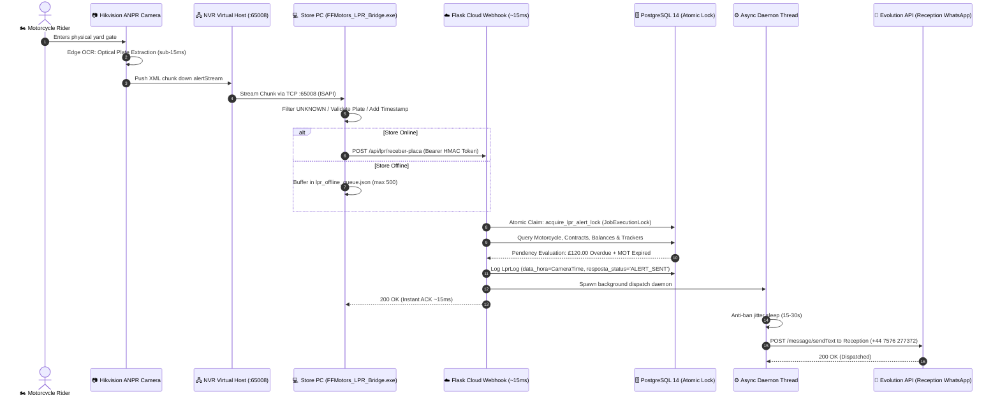

# 🏍️ Enterprise Fleet, FinTech Ledger & AI Operations Platform (UK Market)
### Production Architecture Showcase & Systems Engineering Case Study

[-success?style=for-the-badge&logo=statuspage&logoColor=white)](#)
[-4285F4?style=for-the-badge&logo=googlecloud&logoColor=white)](#)

[-000000?style=for-the-badge&logo=flask&logoColor=white)](#)

 

> 🔒 **Commercial Production Notice for Recruiters & Engineering Hiring Managers**  
> This repository is an **Architectural Case Study & Systems Engineering Showcase** of a proprietary Vertical SaaS / ERP platform operating in live daily commercial production in **Birmingham, United Kingdom**.  
> Designed, architected, deployed, and maintained end-to-end by **[Thiago Brandão](https://linkedin.com/in/tmuniz570)** across **130+ iterative production releases**.

---

## 🎯 Executive Summary (The 30-Second Overview)

Commercial motorcycle rental and rent-to-buy dealerships in the United Kingdom operate at the intersection of **high-frequency recurring billing**, **strict British statutory vehicle compliance (DVLA, MOT, askMID, PCNs)**, **physical yard inspections**, and **legal contract enforcement**. Off-the-shelf CRMs fail to unify these workflows, leading to revenue leakage, double-billing bugs, compliance fines, and manual spreadsheet chaos.

This platform is a **custom-engineered, full-stack Enterprise Resource Planning (ERP) & FinTech Operational System** built from the ground up in **Python (Flask 3.0)** and **PostgreSQL 14**, hosted on **Google Cloud Platform (GCP)** behind hardened **Nginx** edge proxies, and augmented by an autonomous **Google Gemini 3.5 Flash Executive AI Copilot** with a zero-trust **Read-Only Text-to-SQL Engine** and **Multimodal OCR**.

### 📊 Production Scale & Engineering Benchmarks

| Engineering Metric | Production Benchmark | Architectural Driver |
| :--- | :--- | :--- |
| **Active Commercial Scale** | **200+ Fleet Vehicles** | Real-time lifecycle tracking (`Available`, `Rented`, `Financed`, `Maintenance`, `Pound`, `Claim`, `Sold`, `Decommissioned`) |
| **Internal API Latency** | **~3.9ms P50 / <100ms Cold** | SQLAlchemy `joinedload` eager loading, composite B-tree indexes, and 07:45 AM RAM buffer warm-up |
| **Edge IoT Gatekeeper Latency** | **<15ms Edge Push Streaming** | Hikvision ISAPI `alertStream` continuous socket, offline FIFO queue, and Windows System Tray daemon |
| **Production Maturity** | **v1.9.134 (134+ Releases)** | Domain-driven modular architecture (11 Flask Blueprints) + zero-downtime Git Hook CI/CD to GCP (`systemd` + Gunicorn) |
| **Automated Test Coverage** | **258+ Tests (61 Test Suites)** | Isolated ephemeral DB runner (`run_tests.py`) with mocked AI/WhatsApp gateways (Zero-Token CI testing) |
| **Media Bandwidth Savings** | **~85% Payload Reduction** | Client-side HTML5 Canvas + Web Worker conversion to WebP prior to mobile 4G/5G upload |
| **AI Copilot Architecture** | **6+1 Multi-Turn Agent** | 12 specialized tools, AST-sandboxed Text-to-SQL (`SELECT`/`WITH`), Multimodal Vision OCR, and PII masking |
| **System Availability** | **99.9% Production Uptime** | Multi-worker Gunicorn WSGI, POSIX `fcntl.flock` concurrency locks, and automated nightly `pg_dump` backups |

---

## 🏛️ 1. High-Level Cloud & System Architecture

---

## 🧠 2. Deep-Dive Engineering Case Studies (STAR Format)

### Case Study 1: Autonomous Executive AI Copilot — Multi-Turn Text-to-SQL, Multimodal OCR & Zero-Trust GDPR Governance
* **The Challenge:** Dealership executives needed instant answers to complex, ad-hoc cross-domain questions (e.g., *"Which customer has the worst payment behaviour across active contracts?"*, *"Does vehicle GV24KHY have valid insurance uploaded, and when does the policy expire?"*, or *"List all Forza 350 contracts with pre-delivery compliance gaps"*). Static dashboard charts could not anticipate every operational query, while raw LLM database access posed severe security, PII leakage, and hallucination risks.
* **The Architectural Solution:** Engineered an in-house **Multi-Turn AI Agent (`ai_service.py`)** powered by **Google Gemini 3.5 Flash (`gemini-3.5-flash`)**:
  1. **12 Specialized Domain Tools + Read-Only Text-to-SQL Sandbox (`tool_execute_readonly_sql`)**: Combines high-level domain tools (360° Customer Dossier, Pre-Delivery Compliance Calculator, Claims & Referral Tracker, Fleet/V5C/GPS Inspector) with a strict ANSI SQL execution engine. The SQL sandbox enforces `SELECT` / `WITH` (CTEs) only, blocks all DML/DDL keywords (`INSERT`, `UPDATE`, `DELETE`, `DROP`, `ALTER`, `TRUNCATE`, `GRANT`, etc.) via word-boundary regex, forbids stacked queries (`;`), blocks credential columns (`senha_hash`), injects `LIMIT 100`, and normalizes PostgreSQL `INTERVAL` (`datetime.timedelta`), `Decimal`, `UUID`, and `date` types for lossless JSON serialization.
  2. **6+1 Multi-Turn Chaining & Final Synthesis Pass**: Supports up to **6 consecutive tool-calling turns** so the agent can introspect schema metadata (`DB_SCHEMA_METADATA`), execute exploratory SQL queries, cross-reference document attachments, and—if all 6 turns are spent gathering data—automatically trigger a **7th synthesis pass (`tools=None`)** to guarantee a structured executive response.
  3. **Multimodal Vision OCR (`ler_conteudo_documento`)**: Reads uploaded PDFs and WebP images directly from disk into Base64 `inlineData` payloads, enabling the AI to visually inspect insurance certificates (`url_seguro`), V5C logbooks, and driving licences to verify policy numbers and expiry dates in real time.
  4. **Resilience & Cost Governance**: Features automatic exponential backoff retry (`max_retries=2`) on transient `HTTP 503/429` upstream spikes, automatic UK GDPR PII masking (`mask_phone`, `mask_email`, `mask_address`), Root-only configuration locks (`HTTP 403` for non-root admins), a shared organizational cap of **150 queries/day**, and real-time USD token accounting (`$0.075/1M` input, `$0.300/1M` output).

---

### Case Study 2: Eliminating Race Conditions in Autonomous Recurring Billing & Messaging
* **The Challenge:** In a production Linux cloud environment running multiple **Gunicorn WSGI worker processes**, background schedulers (`APScheduler`) initialize inside each worker process. Without distributed coordination, the 01:00 AM recurring weekly billing job and the 08:00 AM WhatsApp collection job would execute concurrently across workers—resulting in catastrophic double-billing and duplicate customer messages.
* **The Architectural Solution:** Engineered a **Three-Tier Concurrency & Idempotency Shield**:
  1. **OS Kernel Advisory Locks (`fcntl.flock`)**: Workers compete for an exclusive non-blocking POSIX file lock (`LOCK_EX | LOCK_NB`) on `/tmp/ffmotors_scheduler.lock` before entering any scheduled task.
  2. **Database Atomic Execution Locks (`JobExecutionLock`)**: A dedicated lock table (`job_name`, `last_run_date`, `updated_at`) executes an atomic conditional SQL update ensuring each daily job (`daily_billing`, `morning_warmup`, `whatsapp_reminders`, `deposit_hold_alerts`) can only commit once per calendar day in `Europe/London` time.
  3. **Two-Phase WhatsApp Dispatch Reservations (`status='DISPATCHING'`)**: Before sleeping for anti-ban jitter (15–30s) or invoking the external HTTP gateway, the worker atomically commits a `DISPATCHING` log row (`WhatsAppMessageLog`). Concurrent threads or manual triggers check `already_sent_today_for_transaction` and skip any charge already `SENT` or `DISPATCHING` (with automatic 10-minute stale lock reclamation if a worker crashes mid-flight).

---

### Case Study 3: Resilient WhatsApp Gateway with Anti-Zombie Socket Detection & UK Legal Safe-Harbor
* **The Challenge:** Unofficial WebSocket bridges (Baileys / Evolution API v2) frequently suffer from "zombie sessions"—where the internal Prisma database reports `connectionStatus == "open"`, but the underlying WhatsApp Web socket is actually dead (`SessionError: No sessions` or `Connection Closed`), causing batch reminder dispatches to fail silently. Furthermore, automated debt reminders in the UK must strictly comply with the *Protection from Harassment Act 1997* and *Road Traffic Act 1988*.
* **The Architectural Solution:**
  * **Live Socket Ping Verification (`check_evolution_connection`)**: Bypassed naive status endpoints by combining `/instance/fetchInstances` timestamp comparison (`updatedAt > disconnectionAt`) with a **live WhatsApp network socket ping** (`/chat/whatsappNumbers/{instance}`) against a known UK control number (`+44 7736 569665`). The UI only displays `Online` when the live Baileys socket confirms real-time WhatsApp network reachability.
  * **Resilient Auto-Retry with Backoff (`dispatch_whatsapp_message`)**: Built a multi-attempt retry loop (`max_retries=2`, sleeping `3.0s` then `5.0s`) that automatically recovers from transient Baileys socket drops (`HTTP 500/502/503/504`, `Connection Closed`, `SessionError`, `RemoteDisconnected`) while failing fast on permanent errors (`401`, `422`).
  * **3-Tier Silencing Hierarchy (`is_transaction_reminder_paused`)**: Operators can snooze individual ledger charges (`+3`, `+7`, `+14 days`, or permanent mute), silence a specific contract, or mute a VIP customer globally.
  * **UK Legal Safe-Harbor Templates**: Automated templates (`due_today`, `overdue_d1`, `overdue_d2`, `overdue_3plus`, `mot_30d`, and internal `deposit_hold_14d` quarantine alerts) enforce **Title Case full-name greetings**, **zero bank account details in chat** (preventing phishing liability), a payment-disregard safe-harbor clause, official landline support (`0121 492 0697`), and statutory citations (*Section 47 of the Road Traffic Act 1988* for MOT compliance).

---

### Case Study 4: Double-Entry-Inspired FinTech Ledger & 14-Day Deposit Quarantine State Machine
* **The Challenge:** Vehicle rental operations deal with messy real-world payment scenarios: partial weekly payments, retroactive rate adjustments, promotional discounts, early vehicle returns, security deposit deductions for traffic fines (PCNs) or damage, and dealership motorcycle sales paid in weekly instalments.
* **The Architectural Solution:**
  * **Partial Settlement Child Splitting (`⚡ Bal #ID`)**: When a rider pays part of a weekly charge (e.g., pays £100 of a £150 rent invoice), the ledger settles the parent transaction for £100 (`Pago`) and automatically spawns a linked child transaction (`transacao_origem_id`) for the £50 remaining balance (`⚡ Bal #ID`), preserving exact historical cash-flow dates while tracking outstanding arrears.
  * **Bi-Directional Reversal & Cascade Deletion**: Reversing a settled parent charge (`Estornar`) or deleting an erroneous entry automatically reconciles or purges orphaned child balance splits and recalculates contract totals atomically.
  * **14-Day Security Deposit Quarantine (`Deposit_Hold`)**: When a rental bike is returned (`Devolvido`), operators can transition the contract into a **14-day statutory quarantine (`Deposit_Hold`)** while awaiting delayed UK council/police Penalty Charge Notices (PCNs). The vehicle is immediately released back to `Disponível` for re-hire, future billing stops, and an autonomous 09:00 AM monitor alerts management on Day 14+ to finalize deposit deductions or refunds.

---

### Case Study 5: UK Legal Tech — Cryptographic Remote e-Signing (`/assinar/<token>`) & Zero-Overflow A4 Print Engine
* **The Challenge:** Paper contracts slow down vehicle handovers, get lost in the yard, and fail to bind remote guarantors or riders renewing agreements from home. Moreover, browser-to-PDF printing (`window.print()` / `html2pdf.js`) notoriously suffers from orphaned signature blocks and phantom blank pages.
* **The Architectural Solution:**
  * **4 Dynamic UK Contract Archetypes**: Supports **Weekly Rental Agreement**, **Rent-to-Buy / Sale by Instalments**, **Outright Cash Sale Receipt**, and **Dealership Vehicle Purchase Invoice (Trade-In / Acquisition)**.
  * **Cryptographic Remote Signing Portal (`/assinar/<token>`)**: Generates 1-hour URL-safe cryptographic tokens (`secrets.token_urlsafe(32)`). Riders open the link on their smartphone via WhatsApp, review the full legal agreement in a scrollable viewport, check an explicit statutory consent box (*Electronic Communications Act 2000, s.7* & *UK eIDAS*), and sign on an HTML5 touch canvas.
  * **Forensic Tamper-Proof Freeze (`HTTP 409 Conflict`)**: Upon submission, the backend records the signer's real IP (`CF-Connecting-IP` / `X-Forwarded-For`), device `User-Agent`, and `Europe/London` timestamp, freezes an immutable JSON snapshot of the client/vehicle state, locks the token against replay (`409 Conflict`), and embeds all verification IDs (Driving Licence, CBT, Proof of Address) as inline **Base64 Data URIs** (`file_url_to_data_uri`) so private `/static/uploads/` files remain strictly behind `@login_required`.
  * **Schedule 1 Safe-Harbor Customer Warranty**: Formulates attached customer KYC documents as an affirmative legal warranty by the signatory under English Law, protecting the dealership against third-party document forgery while satisfying *Road Traffic Act 1988* custody records.
  * **Deterministic A4 Page Budgets**: CSS `@media print` rules enforce strict page budgets (**4 pages** for Rental/Instalments with Schedule 1 docs, **3 pages** without; **3 pages** for Outright Sale with docs, **2 pages** without; **1 single page** for Purchase Invoices) with cross-page `Agreement #<ID> • Page X of Y` footers and zero page-overflow drift.

---

### Case Study 6: High-Density PostgreSQL Tuning, Zero Cold-Start Warm-Up & Edge Security
* **The Challenge:** Cloud VMs experience I/O latency spikes on the first morning queries when PostgreSQL buffer caches are cold, while public IPv4 endpoints face relentless automated vulnerability scanning (`.env`, `.git`, `/wp-admin`, `/owa`, botnet User-Agents).
* **The Architectural Solution:**
  * **Kernel & Buffer Tuning + 07:45 AM Autonomous Warm-Up (`run_morning_system_warmup`)**: Configured Linux kernel `vm.swappiness = 10` on Ubuntu 22.04 LTS (GCP Kernel 6.8) and scheduled a 07:45 AM worker that pre-warms SQLAlchemy connection pools and loads active motorcycles, contracts, and pending financial ledgers into PostgreSQL `shared_buffers` 15 minutes before automated WhatsApp jobs and 75 minutes before store opening—delivering **~3.9ms internal API latency**.
  * **Dual-Layer Scanner Shield (Nginx + Flask)**: Nginx immediately drops malicious scanning User-Agents (`masscan`, `zgrab`, `nikto`, `sqlmap`) with `403 Forbidden` and returns sub-millisecond silent `404 Not Found` (`access_log off`) for exploit probe paths. At the application layer, Flask verifies `request.endpoint is not None` before triggering `@login_required` redirects, ensuring unrecognized bot URLs receive an instant `404` instead of flooding `/login`.
  * **Forensic Authentication & B-Tree Audit Trail (`AuditLog`)**: Captures real client IP, OS, Browser, Device Type, and Language across all `LOGIN_SUCCESS`, `LOGIN_FAILED` (with 10-attempt account lockout protection), `LOGOUT`, and `SESSION_EXPIRED` events. Every state change across the ERP automatically extracts and indexes `placa` (with alphanumeric regex validation preventing system message false positives), `id_contrato`, and `cliente_nome` for sub-millisecond forensic filtering and 1-click CSV export.

---

### Case Study 7: Mission-Critical Asset Telematics, Rent-to-Buy Lifecycle Machine & Dual-Metric Fleet Utilization
* **The Challenge:** In high-volume commercial motorcycle rental and Rent-to-Buy dealerships, GPS telematics hardware represents both the primary defense against vehicle theft and an expensive capital asset. In early iterations, tracker recovery alerts fired naively on contract financial balance or simple vehicle handovers. This generated catastrophic false alerts (e.g. demanding removal of trackers on bikes that were still financed and circulating on the road) or missed recoveries (leaving company-owned trackers on bikes whose ownership had formally transferred to the customer). Furthermore, operations dashboards suffered from metric ambiguity when vehicles were returned but placed in statutory security deposit quarantine (`Deposit_Hold`), leading managers to perceive false discrepancies between active contracts and vehicles physically on the road.
* **The Architectural Solution:**
  1. **Strict Decoupling of Contract Intent & Physical Asset State Machine (`MotoStatus.FINANCED` vs `MotoStatus.SOLD`)**: Replaced implicit assumptions with explicit domain state modeling. When a Rent-to-Buy agreement reaches zero balance, the vehicle does not automatically become `Sold`; it only transitions to `Sold` upon definitive title transfer. While an agreement is in progress, the motorcycle is formally designated as `Financed` (or `Rented`), strictly isolated from outright `Sold` inventory.
  2. **Universal Tracker Removal State Invariant**: Formulated the ironclad operational telemetry rule: *A company GPS tracker must ONLY be removed when the motorcycle status is strictly `Sold`*. Under `Financed`, `Available`, `Rented`, `Maintenance`, or `Pound`, FF Motors retains title and asset liability, so company hardware remains protected.
  3. **Dual-Metric Governance & Mathematical Transparency**: Formulated and surfaced the operational distinction between **Active Deals on Road (96 Vehicles)** — motorcycles physically rented or financed in circulation generating operational risk — and **Open / Active Contracts (99 Agreements)** — which includes 3 contracts in 14-day statutory `Deposit_Hold` quarantine where the physical bikes have already been returned to yard inventory (`Disponível`).
  4. **Multi-Table SQLAlchemy Isolation & 8-Card Interactive Dashboard**: Fixed multi-table SQLAlchemy query isolation (`PropComparator.any(db.and_(...))`) to eliminate cross-subquery pollution across combined filters (`status`, `tracker_company`, `deposit_status`), backed by 8 real-time KPI filter pills on the `/motos` fleet operations console.

---

## 🗄️ 3. Relational Database Architecture (PostgreSQL 14 Schema)

The persistence layer is modeled in **SQLAlchemy 2.0** over **PostgreSQL 14**, comprising **15 normalized tables** with strict foreign-key integrity and composite B-tree indexing:

| Domain | Core Tables | Key Engineering Features |
| :--- | :--- | :--- |
| **Fleet & Statutory Assets** | `motos`, `motos_v5c`, `motos_rastreadores` | Tracks registration plate (`placa`), VIN (`chassi`), purchase cost, `tax_sorn` DVLA flag, `vencimento_mot`, `vencimento_tax`, multi-page V5C logbooks, native lifecycle states (`Available`, `Rented`, `Financed`, `Maintenance`, `Pound`, `Claim`, `Sold`), and GPS tracker serial history with universal recovery rules. |
| **CRM & KYC Compliance** | `clientes`, `anexos_cliente` | Stores UK driving licence numbers, CBT expiry dates, masked PII fields, bi-weekly `askMID` verification counters, and WhatsApp silencing flags. |
| **Agreements & e-Signing** | `contratos`, `anexos_contrato` | Supports `Rent`, `Sale_Installment`, `Sale_Cash`, and `Purchase` types, cryptographic signing tokens, forensic IP/User-Agent stamps, and `Deposit_Hold` quarantine timestamps. |
| **FinTech Ledger** | `financeiro` | Bi-directional ledger (`Receita` / `Despesa`), self-referential `transacao_origem_id` for partial payment child splits (`⚡ Bal #ID`), PCN fine recharges, and per-charge snooze dates. |
| **Yard Inspections & Claims** | `vistorias`, `claims` | Check-in/Check-out fuel, mileage, WebP damage photos, touch signatures, plus UK accident claim workflows (`McAms`, `ALS`, `365`) with 14d referral & 28d storage fee SLAs. |
| **AI Copilot & Governance** | `ai_chat_settings`, `ai_chat_sessions`, `ai_chat_messages` | Tracks Gemini model config, shared 150/day organizational quota, real-time USD token spend (`custo_acumulado_mes`), tool invocation logs, and 30-day auto-retention. |
| **Security, Locks & Comms** | `usuarios`, `logs_auditoria`, `whatsapp_logs`, `job_execution_locks` | Granular RBAC permissions (`perm_motos`, `perm_contratos`, `perm_financeiro`, `perm_ia`, `is_root`), two-phase WhatsApp dispatch logs, and atomic daily job locks. |

---

### Case Study 8: Real-Time Edge IoT & ANPR Gatekeeper — Hikvision ISAPI alertStream, Store Bridge Daemon & Offline Resiliency
* **The Challenge:** Physical yard access control and customer greeting required staff to manually check motorcycle registration plates upon arrival, inspect ledger balances on the office desktop, and verify whether the customer had overdue rent, missing GPS trackers, or expired MOTs. When staff were busy in the workshop, delinquent or unverified riders would enter and leave unnoticed. Furthermore, the dealership operates in a physical store where internet connections can fluctuate, and the ANPR camera sits on an isolated internal NVR PoE subnet (`192.168.254.x`).
* **The Architectural Solution:**
  1. **NVR Virtual Host & HTTP Chunked Push Streaming (`alertStream`)**: Routed the Hikvision ANPR camera through the NVR LAN (`192.168.1.49`) Virtual Host on port `65008`. The bridge maintains a continuous HTTP connection (`GET /ISAPI/Event/notification/alertStream`) using Digest Auth. Rather than polling, the camera pushes structured XML down the open socket in sub-15ms time upon plate recognition.
  2. **Store Windows Background Daemon (`FFMotors_LPR_Bridge.exe`) & System Tray Integration (`pystray` + `PIL`)**: A lightweight compiled background binary (~25MB RAM, 0% CPU) with Windows System Tray integration near the clock (dynamic tooltip, green status beacon, and context menu to open web dashboard, inspect logs in Notepad, or clean shutdown).
  3. **Offline Resiliency & Persistent FIFO Queue (`lpr_offline_queue.json`)**: Buffers up to 500 readings on disk during local internet outages. An autonomous flusher thread restores delivery upon reconnection.
  4. **Optical Timestamp Precision & Stale Alert Suppression**: Preserves true camera capture time in `Europe/London` time. Delayed arrivals (>15m) are logged historically in the database but WhatsApp alerts to reception are suppressed (`OFFLINE_SYNC_EXPIRED`) to prevent false alarms.
  5. **Intelligent OCR Filtering & Database Auto-Purge**: Discards unreadable OCR detections (`UNKNOWN`, `UNREAD`, `NOPLATE`, `NONE`, `NULL`, `DESCONHECIDO` or length < 2) at the edge bridge and cloud webhook, backed by boot-time database self-healing.
  6. **Automated Pendency Audit & Reception WhatsApp Dispatch**: Instantly checks overdue balance (£), missing hardware GPS trackers on rentals, company trackers on sold bikes, MOT/Tax expiry, and customer KYC compliance. Operates strictly on active on-road agreements (returned motorbikes in `Deposit_Hold` quarantine are 100% exempt from compliance alerts). Alerts are dispatched exclusively to the Reception Staff (`+44 7576 277372`), never messaging the customer.
  7. **Asynchronous Dispatch & Multi-Worker Atomic Lock (`JobExecutionLock`)**: Outgoing WhatsApp alerts with humanized anti-ban jitter (15–30s) are dispatched asynchronously in a detached daemon thread, allowing `/api/lpr/receber-placa` to return `HTTP 200 OK` in ~15ms (eliminating store bridge timeouts). Multi-worker race conditions between parallel Gunicorn workers are eliminated via an atomic conditional SQL reservation lock (`JobExecutionLock`), ensuring exactly one alert per 30-minute debounce window.
  8. **Workshop Debtor Watchlist & Decoupled Parallel Triage (`WorkshopWatchlist`)**: Dealerships with adjacent repair garages manage external repair debts. To alert front-desk reception without polluting internal fleet inventory (`Motorcycle`), the LPR engine runs parallel evaluation across internal contracts and external workshop debtor plates. Upon optical recognition, external debtor motorbikes trigger instant WhatsApp alerts to reception (`🔧 Workshop Debt: Pending balance in workshop system (£{val} - {motivo})`), recording `encontrada_frota=False`. Once settled, records are immediately hard-deleted (`DELETE`), preventing dead row accumulation while historical invoices remain safely stored inside the workshop ERP. Accessible via a dedicated responsive dashboard modal engineered under Apple HIG (44px touch targets, zero-zoom 16px iOS fonts, and full dark glassmorphic styling).

---

### Case Study 9: Domain-Driven Blueprint Modularization, Zero-Trust Security Hardening & 3-Layer Infrastructure Observability
* **The Challenge:** As the ERP scaled past 130+ commercial releases, the core routing layer grew to over 13,000 lines, increasing cognitive load. Simultaneously, enterprise UK GDPR audits required strict guarantees around credential encryption at rest, protection against disguised malicious uploads (e.g., SVG/HTML XSS or executables renamed as `.jpg`/`.pdf`), deterministic retention limits for ANPR camera logs, and proactive server disk space alerting before storage exhaustion could impact PostgreSQL or vehicle check-in uploads.
* **The Architectural Solution:**
  1. **Domain-Driven Modularization (11 Flask Blueprints, -73% Core Footprint)**: Decoupled the application into 11 cohesive domain Blueprints (`contratos_api`, `financeiro_api`, `motos_api`, `clientes_api`, `vistorias_api`, `trackers_api`, `claims_api`, `usuarios_api`, `whatsapp_api`, `ai_api`, and `lpr_api`), reducing `app.py` by **73%** (from 13,194 to 3,591 lines) while preserving 100% URL and frontend backward compatibility.
  2. **API Key Encryption at Rest (`enc:v1:`) & Alias-Proof SQL GDPR Masking**: External API keys (`AIChatSetting.api_key` and `WhatsAppSetting.api_key`) are encrypted at rest via an HMAC-SHA256 CTR stream cipher derived from `SECRET_KEY`. In the AI Copilot's `tool_execute_readonly_sql`, enforced module-level RBAC, blocked sensitive columns/functions (`password_hash`, `api_key`, `token_assinatura_*`, `pg_read_file`, `pg_sleep`), and implemented alias-proof (`AS`) + value-pattern UK GDPR PII masking.
  3. **Global Upload Magic-Bytes Inspection & Sliding-Window Rate Limiting**: Added global `@app.before_request` binary signature inspection (`is_safe_file_content`) blocking HTML/SVG/JS/PHP/PE/ELF/ZIP payloads disguised as images or PDFs, alongside thread-safe sliding-window rate limiting (`HTTP 429`) on `/assinar/<token>` and AI/OCR endpoints.
  4. **3-Layer Server Disk Observability & Automated GDPR Retention**: Built a `<5ms` `/api/health` telemetry endpoint (`SELECT 1` + `shutil.disk_usage`), an automatic Admin Dashboard warning banner when disk usage reaches $\ge 85\%$, and a 07:45 AM WhatsApp alert directly to the system architect's personal phone—paired with fixed UK GDPR daily 06:00 AM purges (30 days for ANPR `lpr_leituras`, 30 days for AI sessions, and 180 days for `whatsapp_logs`) and `prune_old_backups(keep=3)`.

---

## 🧪 4. Engineering Quality, Testing & Zero-Downtime CI/CD

* **61 Deterministic Automated Test Suites (258+ Unit & Integration Tests) (`run_tests.py` & `tests/`)**:
  * **Ephemeral Database Test Isolation (`run_tests.py`)**: Clones the local database using SQLite's native atomic backup API (`src.backup(dst)`) into an isolated `FFMOTORS_TEST_DB` instance before running all 61 suites, guaranteeing zero side effects on local development data.
  * Comprehensive coverage across financial ledger math, partial payment reversals, contract numbering, remote e-signature state machines, WhatsApp anti-ban retry loops, audit log forensic extraction, and AI Copilot security.
  * **Zero-Token AI Test Isolation**: Routine unit tests (`test_ai_consultant.py`, `test_ai_copilot.py`) mock `urllib.request.urlopen` and `call_gemini_api` via `unittest.mock.patch`, validating Text-to-SQL AST sandboxing, PostgreSQL `timedelta` serialization, HTTP 503 auto-retry backoff, and 6+1 multi-turn synthesis in `<5 seconds` with **zero live API token cost**.
* **Production Safety & Disaster Recovery**:
  * **Git Hook CI/CD**: Pushing to the `production` remote triggers an automated server-side hook that synchronizes the working tree to `/var/www/ffmotors` and gracefully restarts the `systemd` Gunicorn service.
  * **Nightly Automated Backups**: Cron-scheduled `pg_dump` snapshots with 7-day rolling retention in `/var/backups/ffmotors`, paired with an automated 90-day media lifecycle pruner (`run_cleanup_old_media`) that reclaims disk space from closed inspections while preserving active legal contracts and V5C logbooks.

---

## 🛠️ 5. Complete Technology Stack

| Layer | Technologies & Standards |
| :--- | :--- |
| **Backend & API** | Python 3.10+, Flask 3.0, SQLAlchemy 2.0, Flask-Login, Werkzeug Security, RESTful JSON APIs |
| **AI & Data Science** | Google Gemini 3.5 Flash (`generativelanguage` REST API), Function Calling, Text-to-SQL AST Sandbox, Multimodal Vision OCR |
| **Database & Caching** | PostgreSQL 14 (Production Connection Pool + Warm-Up Worker), SQLite 3 (Local Dev WAL Mode), B-Tree Composite Indexing |
| **Cloud & Infrastructure** | Google Cloud Platform (GCP Compute Engine, Ubuntu 22.04 LTS Kernel 6.8), Docker, `systemd`, Gunicorn WSGI, POSIX `fcntl` |
| **Edge & Networking** | Cloudflare DNS/Proxy, Nginx Reverse Proxy (TLS 1.3, Scanner Shield, `.env`/`.git` 403 Armor, Security Headers) |
| **Messaging & Automation** | APScheduler Background Daemon, Evolution API v2 (Baileys WebSocket), Spintax & Anti-Ban Jitter Engine |
| **Frontend & Mobile PWA** | Vanilla ES6+ JavaScript, Custom Dark Glassmorphism UI (`75vw` Adaptive Drawer), HTML5 Canvas Touch Signatures, Client-Side WebP Compression, Service Worker PWA |
| **UK Legal & Compliance** | Electronic Communications Act 2000 (s.7), UK eIDAS, Consumer Rights Act 2015, Road Traffic Act 1988 (s.47), Protection from Harassment Act 1997, UK GDPR |

---

## 👨‍💻 About the Author & Architect

### **Thiago Brandão**
**Senior Full-Stack Software Engineer • Systems Architect • AI & Data Engineer**  
📍 *Birmingham, England, United Kingdom 🇬🇧*

I specialize in designing, building, and scaling **mission-critical production software, FinTech ledgers, autonomous AI agents, and cloud-native architectures** that solve real commercial problems with measurable business impact.

---

  Copyright © 2026 Thiago Brandão. All architectural specifications, diagrams, and engineering implementations reserved.

