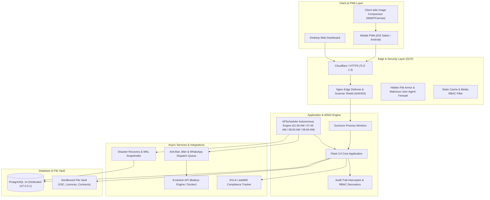

# 🏍️ Enterprise Fleet & Rental Operations Platform (UK Market)
### Architecture Showcase & Engineering Case Study

[-4285F4?style=for-the-badge&logo=googlecloud&logoColor=white)](#)

 

> 🔒 **Proprietary Commercial System Notice**:  
> This repository serves as an **Architecture Showcase, Engineering Documentation, and Case Study**.  
> The underlying production codebase, private schemas, and business integrations are proprietary property operating in live commercial production in Birmingham, United Kingdom.

---

## 📌 Executive Overview

This enterprise system was engineered to solve the complex operational and financial challenges of commercial motorcycle fleet operators in the United Kingdom. 

Operating under heavy daily commercial traffic on **Google Cloud Platform (GCP)** with an internal endpoint latency of **~3.9ms**, the platform automates:
* Multi-tier vehicle rental agreements, rent-to-buy sales agreements, and dealership trade-in acquisitions.
* Recurring weekly billing engines with automated debt escalation and payment reconciliation.
* Mobile-first Progressive Web App (PWA) digital yard inspections with client-side image compression.
* Automated WhatsApp reminders via an anti-ban Baileys microservice.
* British statutory compliance (DVLA SORN, MOT test schedules, and bi-weekly askMID insurance verification).

---

## 🏛️ High-Level System Architecture

---

## 💡 Key Engineering Challenges & Solutions

### 1. Eliminating Race Conditions in Recurring Billing
* **The Problem:** In a multi-worker WSGI cloud environment (Gunicorn), autonomous recurring billing tasks scheduled at 01:00 AM risk executing concurrently on multiple worker processes, resulting in catastrophic double-billing.
* **The Solution:** Implemented a two-phase concurrency shield:
  1. Operating-system level file locks (`fcntl.flock`) on POSIX lockfiles.
  2. Database-backed atomic conditional update locks (`JobExecutionLock`) ensuring that daily billing routines execute strictly once per calendar day regardless of server reboots or multiple worker triggers.

### 2. High-Density Database & Zero Cold-Start Latency
* **The Problem:** Cloud database instances often suffer from morning "cold starts" where initial operator queries experience high I/O wait times as data pages are loaded from disk to RAM.
* **The Solution:** 
  * Tuned Linux OS kernel parameters (`vm.swappiness = 10`) on Ubuntu Jammy (Kernel 6.8 GCP) to prioritize RAM residency for PostgreSQL and Gunicorn processes.
  * Engineered an autonomous **Morning Warm-Up Worker** scheduled at 07:45 AM Europe/London (15 minutes prior to automated messaging and 1h15m prior to store opening) to pre-warm PostgreSQL connection pools and populate frequently accessed fleet and contract ledgers into `shared_buffers`, achieving **<100ms first-response times** for operators.

### 3. WhatsApp Messaging Gateway with Anti-Ban Protection
* **The Problem:** Automated financial reminders over WhatsApp are susceptible to instant telephone number bans by Meta algorithms if dispatched with rigid cadence or duplicate payloads.
* **The Solution:**
  * Containerized Baileys engine (Evolution API v2) connected via isolated Docker instances.
  * Humanized anti-ban suite incorporating dynamic Spintax rotation (British English phrasing), simulated `composing...` typing states, and randomized jitter delays (15–30 seconds).
  * Two-phase atomic dispatch reservations (`status='DISPATCHING'`) preventing worker collisions, with automatic 10-minute zombie lock reclamation.
  * Multi-tier silencing hierarchy: Operators can snooze specific charges (`+3`, `+7`, `+14 days`), mute individual contracts, or silence VIP customers.
  * **Internal Operations Alerting & Deposit Hold Quarantine Monitoring:** Automated daily routine (09:00 AM Europe/London) tracking returned vehicle rental agreements in 14-day security deposit quarantine (`Deposit_Hold`). Proactively alerts fleet management via WhatsApp whenever a quarantine completes 14+ days with an unrefunded deposit, prompting inspection sign-off and eliminating delayed customer deposit refunds.

### 4. Bandwidth Optimization for Field Yard Inspections
* **The Problem:** Yard staff upload high-resolution camera photos (5–12MB each) during vehicle intake and check-out, quickly choking cellular 4G/5G connections and inflating cloud storage costs.
* **The Solution:** Implemented client-side image compression via HTML5 Canvas and Web Workers (`browser-image-compression`). Images are compressed and converted into lightweight WebP format directly inside the mobile browser before upload, slashing payload size by **~85%** while maintaining crisp visual resolution for inspection dispute audits.

### 5. UK Regulatory & Legal Compliance & Remote Mobile Signing Portal
* **DVLA & askMID Verification:** Automatic 15-day recurring checks against the government insurance database (`askMID`), with automatic exemption for vehicles officially declared off-road via **DVLA SORN** (`tax_sorn = True`).
* **Paperless Legal Agreements & Remote WhatsApp Signing (`/assinar/<token>`):** Dynamically compiled agreements under English Law (*Electronic Communications Act 2000, s.7* & *UK eIDAS*) featuring 1-hour cryptographic signing links (`secrets.token_urlsafe(32)`), embedded full agreement review, explicit legal consent gating, touch-canvas signature pads, and tamper-proof post-signature locks (`HTTP 409 Conflict`) with instant PDF execution receipts.
* **Forensic Audit Trail & Zero-Trust Base64 Media Delivery (UK GDPR):** Automatically records the signer's public IP (`X-Forwarded-For`), device `User-Agent`, and `Europe/London` timestamp while freezing an immutable customer/vehicle snapshot. Private uploads (`/static/uploads/`) remain strictly behind `@login_required` (`302 Redirect`), while customer verification documents and signatures are injected inline as Base64 Data URIs (`data:image/...;base64,...`) with zero secondary HTTP requests.
* **Schedule 1 Identification & Verification Schedule (Safe-Harbor Customer Warranty):** Official contracts dynamically annex a permanent customer verification schedule (Driving Licence Front/Back, CBT, Proof of Address) in high-definition Base64 Data URIs (`file_url_to_data_uri`). Formulated under English Law as an affirmative *Customer Warranty* where the signatory legally warrants the authenticity of their records and indemnifies the company against falsification, PCNs, and traffic violations, eliminating affirmative inspection liability for the business while maintaining good-faith custody under the *Road Traffic Act 1988* and *UK GDPR*.
* **Prominent Agreement Reference Numbering & Cross-Page Traceability:** Displays prominent `Agreement Reference: #<ID>` badges under Page 1 headers and cross-references `Agreement #<ID> • Page X of Y` across every single page footer.
* **Strict Zero-Overflow A4 Print Budgets:** Precision layout calibration ensuring balanced page budgets: 4 pages for Rental/Instalments with docs (3 without), 3 pages for Outright Sale with docs (2 without), and calibrated single-page printing for Purchases with zero orphaned signature lines or phantom blank pages.
* **UK Road Signage Authenticity:** Integrated BS AU 145e standard reflective yellow rear plates (`#fde047`) across all mobile and desktop interfaces.

### 6. Edge Hardening & Automated Scanner Defense-in-Depth
* **The Problem:** Cloud compute endpoints constantly receive internet background radiation—automated bots, exploit probes (e.g. Microsoft Exchange OWA, WordPress, phpMyAdmin), and vulnerability scanners. When unrecognized URLs redirect to the login page by default, automated bots can flood the authentication endpoint with blind credential submissions.
* **The Solution:** Implemented a multi-tier defense architecture:
  * **Edge Layer (Nginx):** Immediate `HTTP 403 Forbidden` drop for malicious scanning User-Agents (`got`, `zgrab`, `masscan`, `nikto`, etc.) and a silent sub-millisecond `HTTP 404 Not Found` (`access_log off`) for classic vulnerability probe endpoints (`/owa`, `/wp-admin`, etc.), consuming zero application memory or CPU cycles.
  * **Application Routing (Flask):** The authentication hook verifies route existence against the application routing table before redirecting unauthenticated requests. Unrecognized paths (`request.endpoint is None`) immediately abort with `404 Not Found` rather than exposing the login view, while legitimate operational URLs safely redirect to login.

---

## 🛠️ Technology Stack Breakdown

| Domain | Technology / Architecture |
|---|---|
| **Backend Framework** | Python 3.10+, Flask 3.0, Flask-Login, Flask-SQLAlchemy, SQLAlchemy 2.0 |
| **WSGI & Application Server** | Gunicorn (Linux Multi-Worker) with Waitress fallback for local environments |
| **Database Engine** | PostgreSQL 14 (Production with connection pooling) & SQLite 3 (Development WAL mode) |
| **Edge & Web Proxy** | Nginx with TLS 1.3, CSP sandbox, and automated `.env`/`.git` 403 border shields |
| **Cloud Hosting** | Google Cloud Platform (GCP) Compute Engine with automated nightly disk snapshots |
| **Background Scheduling** | APScheduler (Autonomous background daemon for billing, media pruning, and warm-ups) |
| **Messaging Infrastructure** | Evolution API v2 (Docker / Baileys WebSocket engine) |
| **Frontend & Mobile UI** | Vanilla ES6+ JavaScript, CSS Dark Glassmorphism Design System, Installable PWA |
| **Security & Auditing** | Comprehensive HMAC CSRF, NIST-compliant credential policies, Full Activity Audit Trail |

---

## 📈 Architecture Highlights & Impact

* ⚡ **~3.9ms Internal API Response Time**: Heavily indexed queries, eager-loading with `joinedload`, and elimination of N+1 bottlenecks.
* 🛡️ **Zero Unhandled Financial Drift**: Bi-directional ledger linking, partial settlement child transactions (`⚡ Bal #ID`), and automated reversal reconciliation.
* 📑 **100% Audit Traceability**: Mandatory vehicle plate and customer name tagging across all state-altering events (`AuditLog`).
* 🔒 **UK GDPR Compliance**: Sandboxed file uploads with strict `@login_required` verification, private cache headers, and client-side session timeout shields.

---

## 👤 Engineered By

**Thiago Brandão**  
*Solutions Architect • Full-Stack Systems Engineer • Data Specialist*  
📍 Birmingham, England, United Kingdom 🇬🇧

* 🌐 Website: **[ErroZero-Website](https://tmuniz570.github.io/ErroZero-Website/)**
* 📁 HyperionDev: **[Portfolio Profile](https://www.hyperiondev.com/portfolio/101782/)**
* 💼 LinkedIn: **[linkedin.com/in/tmuniz570](https://www.linkedin.com/in/tmuniz570)**
* 📧 Email: **[tmuniz570@gmail.com](mailto:tmuniz570@gmail.com)**
* 🐙 GitHub: **[@tmuniz570](https://github.com/tmuniz570)**

---

  Copyright © 2026 Thiago Brandão. All architectural specifications and engineering implementations reserved.

